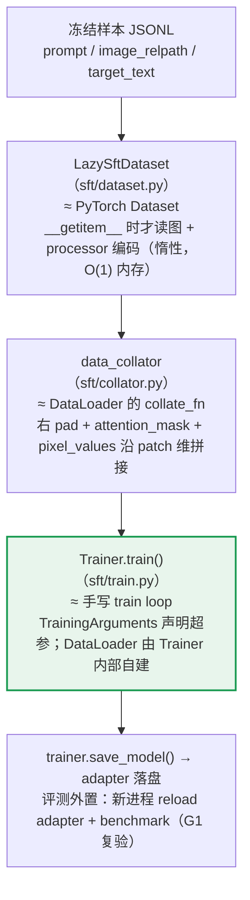

# LoRA SFT 的 HuggingFace 训练核心链路

> 类比 PyTorch 的 `dataset → dataloader → train loop → eval loop`，总结本项目
> （`DriveAlign/src/drivealign/sft/`）实际用到的 HF 训练栈：
> **transformers.Trainer + peft.LoraConfig + 自写 Dataset/Collator**。
>
> 整理日期：2026-10-14；**2026-10-16 修订**：§3.1 单样本编码口径更正为
> `add_generation_prompt=True` 渲染上下文（S13 ctxbug 教训，详见
> `stages_record/S13_contract_and_eval_revision/S13_v7_ctxbug_ab_experiment.md`）。
> 对应代码：`sft/dataset.py` / `sft/collator.py` / `sft/train.py` / `cli/sft_train.py`。

---

## 1. 整体链路图



一句话总览：

- **Dataset 层**：不强制用 `datasets.Dataset`，任何 map-style 对象（有 `__len__` + `__getitem__`）都行；本项目自写惰性 Dataset，在取数时逐条编码。
- **DataLoader 层**：**不可见**。Trainer 根据 `TrainingArguments` 内部自建，用户只需提供 `data_collator`（等价 `collate_fn`）。
- **Train loop 层**：`trainer.train()` 全自动——优化器、lr 调度、梯度裁剪、存档、续训都归 Trainer，代码里找不到 `optimizer.step()`。
- **Eval loop 层**：本项目没走 HF eval（没传 `eval_dataset` / `compute_metrics` / `eval_strategy`），评测外置。

---

## 2. PyTorch ↔ HuggingFace 对照表

| PyTorch 概念 | 本项目的 HF 对应物 | 代码位置 |
|---|---|---|
| `Dataset.__getitem__` | `LazySftDataset`（惰性 map-style）+ `encode_chat` 单样本编码 | `sft/dataset.py` |
| `DataLoader(collate_fn=...)` | **Trainer 内部自建 DataLoader**，用户只提供 `data_collator` | `sft/collator.py` |
| 手写 train loop（forward/backward/opt.step/clip） | `TrainingArguments` 声明超参 + `Trainer.train()` 一把跑 | `sft/train.py` |
| 手写 loss | 不写 loss：`labels` 进模型，CausalLM 内部自动 shift + CE，`-100` 位不参与 | `sft/dataset.py` + 模型 forward |
| eval loop | 未用（外置 reload + benchmark） | `cli/sft_reload_verify` / `cli/base_benchmark` |

---

## 3. 逐层讲解

### 3.1 数据集层 —— "返回已编码张量的 Dataset"

**HF 的用法**：`Trainer` 的 `train_dataset` 接受任何 map-style 对象，不要求是
`datasets.Dataset`。本项目自定义 [LazySftDataset](../../src/drivealign/sft/dataset.py)：

- 构造时只持有冻结样本 JSONL 的**文本记录**（几 MB）；
- 真正的"读图 + processor 编码"推迟到 `__getitem__` 被调用时逐条发生；
- 内存占用与数据集规模无关（O(1)）——S12 全量 22,941 条若预编码，
  仅 `pixel_values` 就约 24 GB，不可行，这是惰性化的直接动机。

**单样本编码**（`encode_chat`）要点：

1. 构造 1F user 消息（image + prompt），`apply_chat_template` 用
   `add_generation_prompt=True` 渲染**带生成前缀**的上下文（止于
   `<|im_start|>assistant\n`），再把目标段手工拼在其后——训练态上下文与
   推理端 generate 的上下文逐位一致。⚠️ 不能用 `add_generation_prompt=False`：
   那样上下文止于 `...<|im_end|>\n`，assistant 开仓标记从未出现，推理时模型
   站在训练未见过的状态续写，格式回退 base 先验（S13 ctxbug 实证，A/B 实验
   定案见 `stages_record/S13_contract_and_eval_revision/S13_v7_ctxbug_ab_experiment.md`；
   旧版本文档曾写反，已于 2026-10-16 更正）。
2. `process_vision_info`（qwen_vl_utils）取图像 → `processor(text, images, ...)`
   得到 `input_ids`（含图像占位 token）、`pixel_values`、`image_grid_thw`。
3. 监督段手工拼接：

   ```python
   full_ids = input_ids + ids_target + [im_end_id]
   labels   = [-100] * len(input_ids) + ids_target + [im_end_id]
   # user 前缀全 -100（不监督）；目标段 + <|im_end|> 全监督
   ```

**为什么 `labels` 里 -100 就是"loss 屏蔽"**：HF 的 CausalLM 在 forward 内部对
`labels` 做 shift 后算 CrossEntropy，`ignore_index=-100` 的位置不产生 loss。
所以训练代码里**没有任何手写 loss**。

### 3.2 Collator 层 —— DataLoader 的 `collate_fn`

**HF 的用法**：`Trainer(data_collator=...)` 的签名是 `callable(batch) -> dict`，
等价于裸 PyTorch 里给 DataLoader 传 `collate_fn`。区别在于：

- DataLoader 本身由 Trainer 按 `per_device_train_batch_size` /
  `gradient_accumulation_steps` / sampler / seed **内部构建**，用户不接触；
- collator 输出的 dict 会被整份透传给 `model(**inputs)`。

[collate_fn](../../src/drivealign/sft/collator.py) 做三件事：

| 侧 | 操作 |
|---|---|
| 文本 | `input_ids` / `labels` 右 pad；pad 处 labels 填 `-100`；生成 `attention_mask`（1=真实，0=pad） |
| 视觉 | 多张图的 `pixel_values` 沿 patch 首维 `torch.cat`；`image_grid_thw` 堆叠为 `(N_images, 3)` |
| 兜底 | `torch.as_tensor` 复位——DataLoader 交付 batch 时会把 tensor 隐式转成 list |

**为什么右 pad**：因果 LM 只关注前缀，右 pad 是 Qwen2.5-VL 训练惯例；
左 pad 会破坏注意力对齐。

### 3.3 Train loop 层 —— 声明式 `TrainingArguments` + `Trainer`

**HF 的用法**：超参全部声明式地写进 [TrainingArguments](../../src/drivealign/sft/train.py)，
循环本身交给 `Trainer.train()`。本项目用到的参数：

```python
TrainingArguments(
    output_dir=output_dir,               # 中间 checkpoint 目录（不能用相对 run_name！）
    per_device_train_batch_size=...,     # micro-batch
    gradient_accumulation_steps=...,     # 梯度累积
    learning_rate=...,
    num_train_epochs=...,                # max_steps>0 时被 HF 忽略
    max_steps=-1,                        # >0 时只跑这么多 optimizer step（smoke/限步用）
    bf16=True,                           # 混合精度
    optim="adamw_torch",                 # 优化器选择
    lr_scheduler_type=...,               # lr 调度
    warmup_ratio=..., weight_decay=..., max_grad_norm=...,
    gradient_checkpointing=...,          # 重计算省显存
    seed=...,
    remove_unused_columns=False,         # 关键：不删列，dict 原样透传给 model(**inputs)
    save_strategy="steps", save_steps=..., save_total_limit=...,
    logging_steps=10, report_to=None,
)
```

`trainer.train()` 内部循环替你做的事：

```
forward（labels 进模型，内部 shift + CE loss）
  → backward
  → grad clip（max_grad_norm）
  → optimizer.step()        ← 在这里，代码里看不到
  → lr scheduler.step()
  → 每 logging_steps 打日志（进 trainer.state.log_history）
  → 每 save_steps 存 checkpoint（含 optimizer / scheduler / RNG state / global_step）
```

因此：

- **续训**：`trainer.train(resume_from_checkpoint=ckpt_dir)`，HF 自动恢复全部状态；
- **限步**：`max_steps > 0` 时 HF 忽略 `num_train_epochs`；
- **训练产物**：`trainer.save_model(output_dir)` 落 adapter（PEFT 场景只存 LoRA 权重），
  指标从 `trainer.state.log_history` 取。

**LoRA 侧（peft）**：

```python
lora_config = LoraConfig(r=..., lora_alpha=..., lora_dropout=...,
                         target_modules=..., task_type="CAUSAL_LM")
model = get_peft_model(model, lora_config)      # 包装成 PeftModel
model.enable_input_require_grads()              # PEFT + gradient checkpointing 必须手动开
```

`target_modules` 要用**路径限定 pattern**（钉在 `model.layers.<n>.` 下），
不能用裸后缀 list——否则视觉塔里同名的 `mlp.{gate,up,down}_proj` 会被静默连带
命中（不报错、loss 正常下降，只有数 adapter 张量数时才暴露）。
本项目用 `assert_text_only_lora_targets` 在训练前做结构断言拦截。

**PEFT + gradient checkpointing 的坑**：`get_peft_model` 不置位
`_hf_peft_config_loaded=True`，HF 不会自动调 `enable_input_require_grads()`；
不手动开的话，reentrant checkpoint 会把逐层输出 detach，backward 报
`element 0 of tensors does not require grad`。

### 3.4 Eval loop 层 —— 本项目故意外置

HF 想要循环内 eval 的**标准姿势**（本项目未用，备查）：

```python
Trainer(model, args, data_collator, train_dataset,
        eval_dataset=eval_dataset,      # ① 提供验证集
        compute_metrics=fn)             # ② 指标回调
args.eval_strategy = "steps"            # ③ 开启评估策略（eval_steps 控制节奏）
```

本项目不这么做的理由：评测口径是"冻结面 + 离线 benchmark + G1 复验"——
训练中的 `eval_loss` 无法替代真实生成质量指标，且循环内 eval 会拖慢训练。
实际流程：

1. 训练结束，`trainer.save_model()` 落 adapter；
2. 训练端在固定样本上贪心生成一次（`run_reference_generation`）作为软层参照，
   与 adapter 权重、`global_step` 一并落盘（`train_state_ref.pt`）；
3. **新进程** `PeftModel.from_pretrained(base, adapter_dir)` 重建模型
   （避免同进程双驻 3B 基座显存，且才能验证"磁盘上的 adapter 能独立加载"）；
4. 跑 `cli/base_benchmark` 评测面 / `sft_reload_verify` G1 复验。

---

## 4. 速查：训练相关坑位（均已在代码注释中钉死）

| # | 坑 | 现象 | 对策（现状） |
|---|---|---|---|
| 1 | `target_modules` 裸后缀 list | 视觉塔被静默包上 LoRA（696 而非 504 张量） | 路径限定 pattern + 训练前 `assert_text_only_lora_targets` 断言 |
| 2 | PEFT + gradient checkpointing | backward 报 `does not require grad` | `get_peft_model` 后手动 `enable_input_require_grads()` |
| 3 | HF Dataset 行索引 | 张量列退化成 list，`embed_tokens` 报 `indices must be Tensor` | 自写 `LazySftDataset` 直接返回张量 + `remove_unused_columns=False` |
| 4 | collator 返回多余 key | `forward() got an unexpected keyword argument` | 返回 dict 的 key 必须全是模型 forward 入参 |
| 5 | `TrainingArguments.output_dir` 用相对 run_name | `save_steps` 触发时在 cwd 凭空建 `./xxx/checkpoint-N` | 显式传 CLI 的 `--out` 绝对路径 |
| 6 | 训练后直接 `generate` | dropout 随机 + KV cache 被关，贪心生成不可复现 | `eval()` + `gradient_checkpointing_disable()` + `config.use_cache=True`（`prepare_model_for_generation`） |
| 7 | 同进程 reload adapter | 双驻 3B 基座（≈6GB 额外显存），且验不出磁盘 artifact 问题 | 强制新进程 `PeftModel.from_pretrained` 复验 |

---

## 5. 最小心智模型

**HF 的分工：你负责"数据怎么编码成 batch"和"超参是什么"，循环本身（优化器、
调度、裁剪、存档、续训）全归 Trainer。**

读代码时找不到 `optimizer.step()`——它藏在 `Trainer.training_step` 里。
想改训练行为，第一反应应该是改 `TrainingArguments`（或 CLI 覆盖开关 /
挂 callback），而不是重写循环。

---

## 6. 最小训练流程代码（可运行骨架）

下面这套 `min_sft.py` 把 §3 各层压缩到最短，**可直接运行**：链路与产线完全一致
（Qwen2.5-VL + LoRA + Trainer），只砍掉冻结 artifact / 面 parity / G1 复验等
工程纪律层。超参默认值取自 `configs/sft/sft_1f.yaml` 的全量口径
（bs=1 / accum=4 / lr=5e-5 / cosine / bf16）。

```python
# -*- coding: utf-8 -*-
"""min_sft.py —— HuggingFace LoRA SFT 最小训练流程（对应本文档 §3 各层）。

用法（GPU 环境，依赖 transformers / peft / qwen-vl-utils）：
    python min_sft.py \
        --samples runs/S12_sft_1f/sft_samples/train_full.jsonl \
        --dataroot data/nuscenes/trainval \
        --out runs/min_sft/checkpoints

链路（≈ PyTorch dataset -> collate_fn -> train loop）：
    §3.1 dataset 层  SftDataset      __getitem__ 时才读图 + processor 编码（惰性）
    §3.2 collator 层 make_collator   右 pad + attention_mask + pixel_values 拼接
    §3.3 train loop  Trainer.train() 优化/调度/裁剪/存档/续训全归 HF，零手写循环
    §3.4 eval 层     不做            训练完只落 adapter，评测走外置 benchmark
"""
import argparse
import json
from pathlib import Path

import torch
from torch.utils.data import Dataset
from transformers import (
    AutoProcessor,
    Qwen2_5_VLForConditionalGeneration,
    Trainer,
    TrainingArguments,
)


# ============================================================ §3.1 数据集层
def encode_sample(processor, prompt: str, image_path: str, target_text: str) -> dict:
    """单样本编码：完整聊天模板 + 手工拼目标段 -> input_ids / labels / 图像张量。

    - 必须用 add_generation_prompt=True 渲染上下文，再把 target 拼在
      `<|im_start|>assistant\n` 之后：这样训练态上下文与推理端
      generate 的上下文逐位一致（推理正是从 assistant 开仓标记后续写）。
      若用 False，训练上下文止于 `...<|im_end|>\n`，开仓标记从未出现——
      推理时模型站在训练未见过的状态续写，格式会回退 base 先验
      （本项目 S13 ctxbug 实证：美化 JSON 缩进发射 > 700 token 预算截断）。
      "训练要把答案编进上下文"没错，错的是把"编进上下文"实现成了
      "渲染时带上答案"——答案拼接与生成前缀是两件事，两者都要：
      True 渲染（止于开仓标记）+ 手工拼 target（接在标记后）。
    - labels：assistant 开仓标记及之前全 -100（不算 loss）；目标段 + <|im_end|> 全监督。
      CausalLM forward 内部自动 shift + CE，因此全程不手写 loss。
    """
    from qwen_vl_utils import process_vision_info

    messages = [{
        "role": "user",
        "content": [
            {"type": "image", "image": image_path},
            {"type": "text", "text": prompt},
        ],
    }]
    text = processor.apply_chat_template(messages, tokenize=False, add_generation_prompt=True)
    image_inputs, _ = process_vision_info(messages)
    inputs = processor(text=[text], images=image_inputs, padding=True, return_tensors="pt")
    input_ids = inputs["input_ids"][0].tolist()

    ids_target = processor.tokenizer(target_text, add_special_tokens=False)["input_ids"]
    im_end_id = processor.tokenizer.convert_tokens_to_ids("<|im_end|>")
    full_ids = input_ids + ids_target + [im_end_id]
    labels = [-100] * len(input_ids) + ids_target + [im_end_id]

    return {
        "input_ids": full_ids,
        "labels": labels,
        "pixel_values": inputs["pixel_values"],
        "image_grid_thw": inputs["image_grid_thw"],
    }


class SftDataset(Dataset):
    """惰性 map-style Dataset：构造时只读文本记录（MB 级），__getitem__ 才读图编码。

    为什么惰性：全量样本的 pixel_values 预编码约 24 GB，不能驻内存；
    HF Trainer 只要求对象有 __len__ / __getitem__，不强制 datasets.Dataset。
    """

    def __init__(self, samples_path: str, processor, dataroot: str):
        self.processor = processor
        self.dataroot = Path(dataroot)
        lines = Path(samples_path).read_text(encoding="utf-8").splitlines()
        self.records = [json.loads(line) for line in lines if line.strip()]

    def __len__(self) -> int:
        return len(self.records)

    def __getitem__(self, idx: int) -> dict:
        r = self.records[idx]
        return encode_sample(
            self.processor,
            prompt=r["prompt"],
            image_path=str(self.dataroot / r["image_relpath"]),
            target_text=r["target_text"],
        )


# ============================================================ §3.2 collator 层
def make_collator(pad_token_id: int):
    """返回 Trainer 可用的 data_collator（等价 DataLoader 的 collate_fn）。

    返回 dict 的 key 必须全是模型 forward 的合法入参——多余 key 会被整份
    透传给 model(**inputs)，直接报 unexpected keyword argument。
    """
    def collate(batch: list[dict]) -> dict:
        max_len = max(len(b["input_ids"]) for b in batch)

        # 文本侧右 pad：input_ids 补 pad_token_id，labels 补 -100（pad 不参与 loss）
        input_ids = torch.full((len(batch), max_len), pad_token_id, dtype=torch.long)
        labels = torch.full((len(batch), max_len), -100, dtype=torch.long)
        for i, b in enumerate(batch):
            n = len(b["input_ids"])
            input_ids[i, :n] = torch.as_tensor(b["input_ids"])   # as_tensor 兜底：
            labels[i, :n] = torch.as_tensor(b["labels"])         # DataLoader 可能交付 list
        attention_mask = (input_ids != pad_token_id).long()

        # 视觉侧：pixel_values 沿 patch 维拼接，image_grid_thw 按 (图, t, h, w) 堆叠
        pixel_values = torch.cat([torch.as_tensor(b["pixel_values"]) for b in batch], dim=0)
        image_grid_thw = torch.cat([torch.as_tensor(b["image_grid_thw"]) for b in batch], dim=0)

        return {
            "input_ids": input_ids,
            "labels": labels,
            "attention_mask": attention_mask,
            "pixel_values": pixel_values,
            "image_grid_thw": image_grid_thw,
        }

    return collate


# ============================================================ §3.3 train loop 层
def main() -> None:
    ap = argparse.ArgumentParser(description="HF LoRA SFT minimal pipeline")
    ap.add_argument("--model", default="Qwen/Qwen2.5-VL-3B-Instruct", help="基座模型路径")
    ap.add_argument("--samples", required=True, help="冻结样本 JSONL（prompt/image_relpath/target_text）")
    ap.add_argument("--dataroot", required=True, help="图像根目录（image_relpath 的前缀）")
    ap.add_argument("--out", required=True, help="adapter / checkpoint 输出目录")
    ap.add_argument("--epochs", type=float, default=1.0)
    ap.add_argument("--lr", type=float, default=5.0e-5)
    args = ap.parse_args()

    # --- 基座 + processor（单副本：processor 编码样本，模型进 Trainer）---
    processor = AutoProcessor.from_pretrained(args.model)
    model = Qwen2_5_VLForConditionalGeneration.from_pretrained(
        args.model, torch_dtype=torch.bfloat16, device_map="auto",
    )

    # --- LoRA 包装（peft）。target_modules 必须路径限定，排除视觉塔 ---
    from peft import LoraConfig, get_peft_model

    lora_cfg = LoraConfig(
        r=16, lora_alpha=32, lora_dropout=0.05,
        # 仅语言解码层：裸后缀 list 会连带命中 visual.blocks.*.mlp.*（静默缺陷，见 §4-1）
        target_modules=r"model\.layers\.\d+\.(self_attn\.(q_proj|k_proj|v_proj|o_proj)"
                       r"|mlp\.(gate_proj|up_proj|down_proj))",
        task_type="CAUSAL_LM",
    )
    model = get_peft_model(model, lora_cfg)
    # PEFT + gradient checkpointing 必须手动开：否则 reentrant checkpoint 把
    # 逐层输出 detach，backward 报 "element 0 of tensors does not require grad"（§4-2）
    model.enable_input_require_grads()
    model.print_trainable_parameters()

    # --- 超参全部声明式（默认值取自 configs/sft/sft_1f.yaml 全量口径）---
    targs = TrainingArguments(
        output_dir=args.out,                  # 必须显式给：save_steps 在此落中间 ckpt（§4-5）
        per_device_train_batch_size=1,
        gradient_accumulation_steps=4,        # 有效 batch = 4
        learning_rate=args.lr,
        num_train_epochs=args.epochs,
        bf16=True,
        optim="adamw_torch",
        lr_scheduler_type="cosine",
        warmup_ratio=0.03,
        weight_decay=0.0,
        max_grad_norm=1.0,
        gradient_checkpointing=True,
        seed=42,
        remove_unused_columns=False,          # 关键：不删列，collator dict 原样进 model(**inputs)
        save_strategy="steps",
        save_steps=500,
        save_total_limit=None,                # 全量保留候选 ckpt
        logging_steps=10,
        report_to=None,                       # 不接 wandb / tensorboard
    )

    trainer = Trainer(
        model=model,
        args=targs,
        train_dataset=SftDataset(args.samples, processor, args.dataroot),
        data_collator=make_collator(processor.tokenizer.pad_token_id),
    )

    trainer.train()               # ← 整个 train loop 就这一行（可传 resume_from_checkpoint=...）
    trainer.save_model(args.out)  # PEFT 场景只落 LoRA adapter 权重


if __name__ == "__main__":
    main()
```

### 6.1 训练完的最小复验（对应 §3.4 外置评测）

```python
# 新进程执行：磁盘重建 PeftModel（同进程 reload 会双驻 3B 基座显存，见 §4-7）
from transformers import Qwen2_5_VLForConditionalGeneration
from peft import PeftModel

base = Qwen2_5_VLForConditionalGeneration.from_pretrained(
    "Qwen/Qwen2.5-VL-3B-Instruct", torch_dtype=torch.bfloat16, device_map="auto",
)
model = PeftModel.from_pretrained(base, "runs/min_sft/checkpoints")  # 挂上 LoRA 权重
model.eval()   # 生成前关 dropout；若训练开过 gradient checkpointing，
               # 还需 gradient_checkpointing_disable() + config.use_cache=True（§4-6）
```

### 6.2 最小代码 ↔ 产线代码对应关系

| 最小代码 | 产线对应 | 产线多做的事（最小版省略项） |
|---|---|---|
| `encode_sample` | `sft/dataset.py: encode_chat / encode_frozen_sample` | 面 parity hash 断言、逐样本 sha256 钉子 |
| `SftDataset` | `sft/dataset.py: LazySftDataset` | encode 以参数注入（可无 GPU 单测） |
| `make_collator` | `sft/collator.py: make_data_collator` | 无图样本兜底（空 tensor） |
| LoRA 包装段 | `sft/train.py: build_lora_model` | `assert_text_only_lora_targets` 结构断言 |
| TrainingArguments 段 | `sft/train.py: make_trainer` | 顶层/阶段/CLI 三层 config 合并、max_steps 语义 |
| `trainer.train()` | `sft/train.py: train` | resume 透传、LoadedModel 单副本显存管理 |
| （无） | `sft/train.py: run_reference_generation + save_train_state_reference` | G1 状态保真参照（adapter 权重 + 固定样本生成参照）落盘 |
| `§6.1 复验` | `sft/train.py: load_adapter_model` + `cli/sft_reload_verify` | 硬层逐张量比对 + 软层生成比对 |
